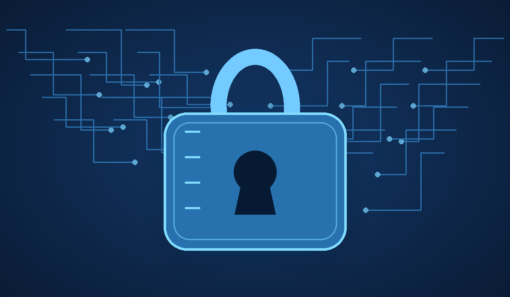

# Ciberseguridad para principiantes

## Cómo proteger nuestros dispositivos y datos

La **ciberseguridad** reúne las medidas que ayudan a proteger dispositivos, redes y datos frente a accesos no autorizados. Es importante utilizar contraseñas *únicas y robustas*, mantener el sistema actualizado y desconfiar de mensajes sospechosos. En Linux podemos utilizar `sudo` para ejecutar tareas administrativas que requieren permisos elevados.

## 1. Principales amenazas

Entre los riesgos más habituales se encuentran:

- **Phishing:** mensajes falsos que intentan robar contraseñas o datos personales.
- **Malware:** programas diseñados para dañar equipos o acceder a información.
- **Ransomware:** malware que cifra los archivos y exige un rescate.
- **Contraseñas débiles:** claves fáciles de adivinar o reutilizadas en varios servicios.
- **Redes Wi-Fi inseguras:** conexiones que pueden exponer información si no se usan con precaución.

## 2. Hábitos básicos de seguridad

Para reducir los riesgos, conviene seguir estos pasos:

1. Usar una contraseña diferente para cada servicio.
2. Activar la autenticación multifactor cuando esté disponible.
3. Instalar actualizaciones del sistema y de las aplicaciones.
4. Hacer copias de seguridad periódicas.
5. Revisar el remitente y los enlaces antes de abrir un mensaje.
6. Descargar programas únicamente desde fuentes fiables.

## 3. Ejemplos de comandos útiles en Linux

Estos comandos permiten revisar información básica del sistema. No sustituyen a un análisis de seguridad completo.

```bash
# Identificar el usuario actual
whoami

# Mostrar la versión del sistema
uname -a

# Ver las direcciones de red del equipo
ip addr

# Consultar los servicios que están escuchando en puertos
ss -tuln
```

## 4. Imagen local sobre ciberseguridad



## 5. Enlaces de interés

- [INCIBE: consejos y recursos de ciberseguridad](https://www.incibe.es/)
- [Centro de ayuda de seguridad de Google](https://safety.google/intl/es_es/security/security-tips/)
- [Documentación de seguridad de Ubuntu](https://ubuntu.com/security)
- [Consultar la documentación complementaria](docs/detalles.md)

## 6. Tabla de amenazas y medidas preventivas

| Amenaza | Riesgo principal | Medida preventiva |
|---|---|---|
| Phishing | Robo de credenciales | Revisar el remitente y la URL |
| Malware | Pérdida o exposición de datos | Actualizar el sistema y descargar programas de fuentes fiables |
| Ransomware | Archivos cifrados o inaccesibles | Mantener copias de seguridad |
| Contraseña débil | Acceso no autorizado | Usar contraseñas largas y únicas |
| Wi-Fi pública | Exposición de información | Evitar operaciones sensibles en redes no confiables |

## 7. Formación y concienciación

La seguridad digital también se aprende mediante la formación. En centros como el **IES Clara del Rey**, los estudios relacionados con la informática ayudan a desarrollar conocimientos técnicos aplicables a la administración segura de sistemas.


*Fotografía de ANAGSPC, publicada en [Wikimedia Commons](https://commons.wikimedia.org/wiki/File:I.e.s._clara_del_rey_(Prosperidad,_Madrid).jpg), bajo licencia [CC BY-SA 4.0](https://creativecommons.org/licenses/by-sa/4.0/).*

## 8. Conclusión

La ciberseguridad depende tanto de las herramientas como de los hábitos de las personas. Mantener los equipos actualizados, proteger las cuentas, comprobar los enlaces y hacer copias de seguridad son medidas sencillas que mejoran la protección de nuestros datos.
